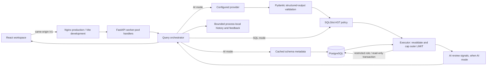

# Architecture

## Components and request flow

- `frontend/src/App.jsx`: workspace, result cards, sorting/pagination, clarification, schema/history/evaluation pages. `src/lib/api.js` centralizes timeouts, JSON handling and actionable error messages. `src/types.d.ts` and JSDoc annotations enable type checking while retaining the existing JavaScript implementation.
- `backend/app/api/routes.py`: validated HTTP boundary. Synchronous endpoints run blocking SQL/provider calls in FastAPI's worker pool. Two query slots and one evaluation slot prevent unbounded simultaneous pipelines within a process; they are not distributed rate limits.
- `services/orchestrator.py::process_query`: coordinates the AI pipeline or dispatches explicit SQL mode. `_remember` stores all handled success, blocked, clarification and error outcomes under a lock; the oldest entries and their feedback are evicted together.
- `services/schema_extractor.py`: SQLAlchemy inspector reads public table/view metadata using the same restricted connection credentials. A locked ten-minute cache avoids repeated introspection. No column-value sampling or row-count scans occur here.
- `services/sql_generator.py`: schema-aware prompts and few-shot examples. `GeneratedQuery` validates SQL length, score range, table list and clarification shape. Clarification is treated as additional natural-language context; the suggested SQL is never blindly executed.
- `services/llm_client.py`: synchronous Anthropic and OpenAI-compatible adapters. Each call has a timeout and output cap. No automatic retries or silent mock provider are enabled. Keys and explicit model IDs are supplied by environment configuration.
- `services/guardrails.py`: SQLGlot parses the PostgreSQL dialect and enforces a single SELECT/set-operation root. It blocks writes anywhere in the tree, SELECT INTO, locking, recursion, non-public/system relations and functions outside a conservative analytics allowlist. Outer LIMIT rewriting covers aggregates, nested LIMITs and oversized limits.
- `services/executor.py`: independently repeats policy enforcement before either EXPLAIN or execution, so alternate generated SQL cannot bypass the safety boundary. A bounded query and bounded fetch replace the original fetch-all-then-slice path. Decimal/date values are converted for JSON.
- `core/database.py`: psycopg URL normalization, five-second connection timeout and configured statement timeout. Execution starts with `SET TRANSACTION READ ONLY` and rolls back in `finally`. Schema introspection no longer needs an admin account. Engines are disposed at application shutdown.

## AI review and limitations

`hallucination_detector.py` combines parse validity, model back-translation alignment, local/model result sanity checks, table-name coverage and optional alternate-query agreement. Unmeasured alternate agreement is `null`, excluded from the weighted denominator and disclosed in review notes. Failed model checks are conservative and visibly flagged. Alternative-query comparison uses a multiset (`Counter`) of **all returned rows**, preserving duplicates while ignoring ordering; it cannot prove equivalence beyond a bounded result or confirm requested ordering semantics.

The confidence number is a heuristic. The same provider generates and reviews SQL, so errors can be correlated. The schema coverage signal uses question keywords and model-reported table names. The database, rather than the parser, establishes final executable SQL validity. Provider prompts can include five result rows; the UI and README disclose this data flow.

The `MIN_CONFIDENCE_TO_EXECUTE` threshold applies to model-reported generation confidence before execution. The final weighted review score is produced **after** a read-only query, not used as a claim of pre-execution semantic safety.

## Data and integrity

Six tables represent customers, products, orders, order items, returns and marketing campaigns; two views summarize revenue and product performance. Existing primary/foreign keys, status checks and unique customer-email/product-SKU constraints are retained. This is synthetic demonstration data, not a financial ledger.

The original product view joined orders with a status predicate after a left join to items. That left join kept the items even when the order did not match, inflating included revenue. `001_product_performance.sql` joins eligible orders to items **before** left-joining that relation to products. Products without eligible sales remain visible. The migration replaces only the view inside a transaction, keeping its column contract and grants; an explicit rollback and a local schema backup support recovery.

Docker initialization only runs for an empty volume. Never rerun the entire seed script against an existing dataset or delete a volume to apply a view change.

## Operational boundary

Nginx serves the built frontend and forwards `/v1`, so browser requests never use an internal Docker hostname. Security response headers are configured there. Compose publishes only loopback ports, persists PostgreSQL storage and uses readiness health checks. Development uses Vite's proxy. Dependencies are pinned directly in Python manifests and resolved through the npm lockfile; Python transitive dependencies and container tags are not fully locked.

`GET /v1/health` proves process liveness; `/v1/ready` performs an actual database connection. Readiness does not validate live model credentials or model availability. Errors expose a safe user-facing explanation while logs retain stage information. Query endpoints return domain outcomes for the UI; malformed requests and infrastructure/transport failures use HTTP error codes.

The deployment target remains a trusted single-user environment. There is no authentication, tenant separation, durable feedback store, cancellation of an already-running provider request, distributed quota enforcement or cross-worker history. A browser timeout does not stop an in-flight server request. Live evaluations are disabled by default, require POST, and perform shape/refusal smoke checks; they are not an accuracy benchmark. Production images are a packaging deliverable, not a certification for public internet deployment.

Quota-saving mode: `ENABLE_AI_REVIEW=false` returns after guarded execution of the generated SQL. It omits back-translation, alignment, result-sanity and alternative-query model calls, returns no confidence score, and explains the skipped review in the result. `LLM_MAX_OUTPUT_TOKENS` bounds each response (default 4096); SDK retries remain disabled. The local screenshot configuration uses 1024 and keeps live evaluations disabled.
