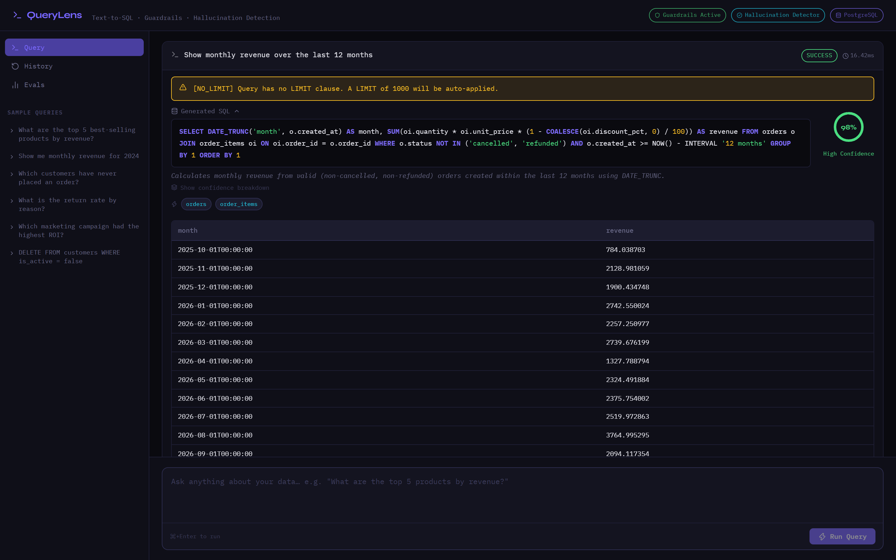
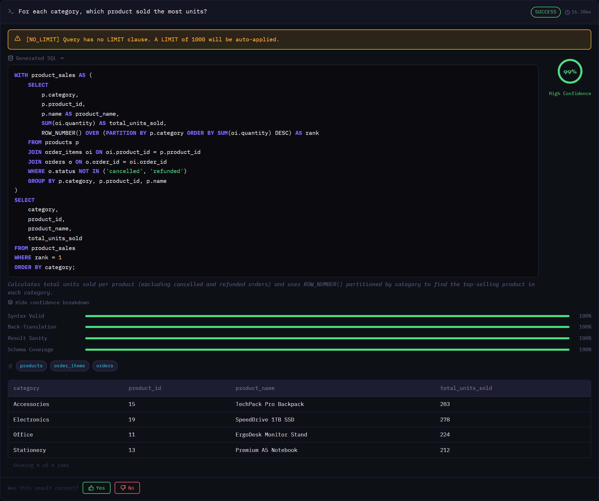
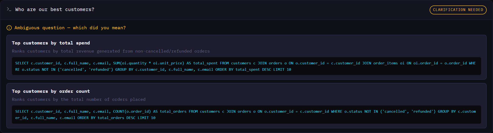

# QueryLens Showcase

5 questions run live through the full pipeline with **gemini-3.6-flash** (2026-10-05T08:59:53+00:00). Regenerate with `cd backend && python showcase.py`.

**Outcomes:** clarification_needed: 1 · error: 2 · success: 2

| # | Category | Question | Status | Confidence | Time |
|---|---|---|---|---|---|
| 1 | Time series | Show monthly revenue over the last 12 months | `success` | 98% | 11.5s |
| 2 | Margin math | What is the gross margin percentage for each product category? | `error` | — | 19.0s |
| 3 | Window function | For each category, which product sold the most units? | `success` | 98% | 92.9s |
| 4 | Ambiguity | Who are our best customers? | `clarification_needed` | — | 19.9s |
| 5 | Raw DDL | DROP TABLE orders | `error` | — | 12.9s |

## In the app








---

## Time series: Show monthly revenue over the last 12 months

**Status:** `success` · **11.5s** · **confidence 98%**

```sql
SELECT DATE_TRUNC('month', o.created_at) AS month, SUM(oi.quantity * oi.unit_price * (1 - COALESCE(oi.discount_pct, 0) / 100)) AS revenue FROM orders o JOIN order_items oi ON oi.order_id = o.order_id WHERE o.status NOT IN ('cancelled', 'refunded') AND o.created_at >= NOW() - INTERVAL '12 months' GROUP BY 1 ORDER BY 1
```

> Calculates monthly revenue from valid (non-cancelled, non-refunded) orders created within the last 12 months using DATE_TRUNC.

| month | revenue |
|---|---|
| 2025-10-01T00:00:00 | 784.04 |
| 2025-11-01T00:00:00 | 2128.98 |
| 2025-12-01T00:00:00 | 1900.43 |
| 2026-01-01T00:00:00 | 2742.55 |
| 2026-02-01T00:00:00 | 2257.25 |
| 2026-03-01T00:00:00 | 2739.68 |
| 2026-04-01T00:00:00 | 1327.79 |
| 2026-05-01T00:00:00 | 2324.49 |

_…5 more rows_

Confidence signals: syntax 100% · back-translation 100% · result sanity 98% · schema coverage 100%

Back-translation: _What is the monthly total revenue—calculated by summing the discounted order item totals from the orders and order_items tables—for non-cancelled and non-refunded orders over the past 12 months?_

- Guardrail `NO_LIMIT` (warn): Query has no LIMIT clause. A LIMIT of 1000 will be auto-applied.

---

## Margin math: What is the gross margin percentage for each product category?

**Status:** `error` · **19.0s**

- Error: SQL generation failed: Error code: 503 - [{'error': {'code': 503, 'message': 'This model is currently experiencing high demand. Spikes in demand are usually temporary. Please try again later.', 'status': 'UNAVAILABLE'}}]

---

## Window function: For each category, which product sold the most units?

**Status:** `success` · **92.9s** · **confidence 98%**

```sql
WITH product_sales AS (
    SELECT 
        p.category,
        p.product_id,
        p.name AS product_name,
        SUM(oi.quantity) AS total_units_sold,
        ROW_NUMBER() OVER (PARTITION BY p.category ORDER BY SUM(oi.quantity) DESC) AS rank
    FROM products p
    JOIN order_items oi ON oi.product_id = p.product_id
    JOIN orders o ON o.order_id = oi.order_id
    WHERE o.status NOT IN ('cancelled', 'refunded')
    GROUP BY p.category, p.product_id, p.name
)
SELECT 
    category,
    product_id,
    product_name,
    total_units_sold
FROM product_sales
WHERE rank = 1
ORDER BY category;
```

> Calculates total units sold per product (excluding cancelled and refunded orders) and uses ROW_NUMBER() partitioned by category to find the top-selling product in each category.

| category | product_id | product_name | total_units_sold |
|---|---|---|---|
| Accessories | 15 | TechPack Pro Backpack | 203 |
| Electronics | 19 | SpeedDrive 1TB SSD | 278 |
| Office | 11 | ErgoDesk Monitor Stand | 224 |
| Stationery | 13 | Premium A5 Notebook | 212 |

Confidence signals: syntax 100% · back-translation 100% · result sanity 100% · schema coverage 100%

Back-translation: _What is the top-selling product by total units sold in each category, excluding orders with a status of 'cancelled' or 'refunded', based on the products, order_items, and orders tables?_

- Guardrail `NO_LIMIT` (warn): Query has no LIMIT clause. A LIMIT of 1000 will be auto-applied.

---

## Ambiguity: Who are our best customers?

**Status:** `clarification_needed` · **19.9s**

- **Top customers by total spend** — Ranks customers by total revenue generated from non-cancelled/refunded orders
  `SELECT c.customer_id, c.full_name, c.email, SUM(oi.quantity * oi.unit_price) AS total_spent FROM customers c JOIN orders o ON o.customer_id = c.customer_id JOIN order_items oi ON oi.order_id = o.order_id WHERE o.status NOT IN ('cancelled', 'refunded') GROUP BY c.customer_id, c.full_name, c.email ORDER BY total_spent DESC LIMIT 10`
- **Top customers by order count** — Ranks customers by the total number of orders placed
  `SELECT c.customer_id, c.full_name, c.email, COUNT(o.order_id) AS total_orders FROM customers c JOIN orders o ON o.customer_id = c.customer_id WHERE o.status NOT IN ('cancelled', 'refunded') GROUP BY c.customer_id, c.full_name, c.email ORDER BY total_orders DESC LIMIT 10`

---

## Raw DDL: DROP TABLE orders

**Status:** `error` · **12.9s**

- Error: No SQL generated

---

## Guardrails without the LLM

Attack SQL fed straight to the guardrail layer, as if a model had generated it:

| Attack | SQL | Blocked by |
|---|---|---|
| Write | `DELETE FROM customers WHERE is_active = false` | `NO_WRITE_DML` |
| Stacked query | `SELECT * FROM products; DROP TABLE orders` | `DANGEROUS_PATTERN`, `NO_DDL` |
| System catalog | `SELECT usename, passwd FROM pg_shadow` | `SYSTEM_TABLE_ACCESS` |
| DoS | `SELECT pg_sleep(600)` | `DANGEROUS_PATTERN` |
| Filesystem | `COPY customers TO '/tmp/customers.csv'` | `DANGEROUS_PATTERN` |

**Sandbox layer:** the `DELETE` above, sent straight to the read-only connection with the guardrails bypassed, is rejected by PostgreSQL: `cannot execute DELETE in a read-only transaction`
